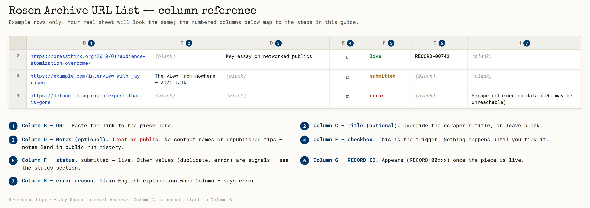

# How to add a piece of writing to the archive

Hi Jay — here's the submission-sheet route for adding a new article, post,
or interview to your archive. Before relying on it, ask the current curator
or technical caretaker to confirm the sheet, its trigger, and the publication workflow
are active by checking a completed submission on the public site. This guide
describes the implemented steps; it does not verify the current account setup.

If the sheet is unavailable, use [Suggest a missing work](https://pressthink.org/j/rosen-archive/features/participate/)
or contact the curator. A public suggestion is a request for review, not an
immediate addition to the archive.

## What you need

1. The URL of the piece.
2. Authorized editing access to the **Rosen Archive URL List** Google Sheet and the submission tab confirmed by the maintainer.

That's it. No software to install, nothing to log into beyond Google.

## The steps

1. Open the sheet.
2. Find the first empty row in the confirmed submission tab. Keep its existing column headings.
3. **Column B:** paste the URL.
4. **Column C** (optional): if you'd like to override the title the
   scraper would otherwise pick, type your preferred title here. Leave
   blank to let the scraper choose.
5. **Column D** (optional): any notes about the piece — context, why
   you chose it, what to highlight. **Treat these as published**: under
   the submission workflow, notes can appear in public GitHub records
   and run history. Don't paste
   anything you wouldn't put in the archive itself — no contact names,
   no unpublished tips, no private commentary. If you need a private
   scratchpad, keep it in a separate Google Doc.
6. **Column E:** click the checkbox. **This is the trigger** — nothing
   happens until you tick this.

**Column F** reports progress, and **Column G** holds the assigned record ID.
Processing time depends on the queue, source website, and workflow state;
there is no guaranteed turnaround. Check **Column H** for an explanation
when the row stops progressing, then contact the maintainer with the row
and record ID rather than creating another copy of the submission.

When the row says `live`, open the assigned record at
[the public archive](https://pressthink.org/j/rosen-archive/) and confirm it
shows the expected piece. A record can be live while carrying **Needs review**:
automated metadata still needs a human check. A successful submission or
repository commit alone does not prove publication.

## The columns at a glance

The numbered callouts map to the columns you'll touch. You only type in
**B** (and optionally **C** and **D**), then tick the checkbox in **E** to
start. Columns **F**, **G**, and **H** fill in on their own as the system
works. The figure above is an illustrative reference, not a screenshot of
the live sheet — the example rows are made up. The current sheet may already
contain submissions; use its first empty row.

## What the status column can say

The workflow can report these states:

- **`submitted`** — the sheet accepted the row and dispatched processing.
- **`processing`** — the workflow has started work on the row.
- **`committed`** — the record is saved in the repository, but live publishing
  is not configured on that runner. Ask the maintainer to publish and verify it.
- **`archived`** — the record is saved, but publication or verification did
  not finish successfully. The maintainer should inspect the error and recover
  the existing record; do not add a duplicate row.
- **`live`** — the publication path reported success. Confirm the record at
  the canonical public archive URL above.
- **`duplicate`** — the URL already has a record. Check the existing record
  ID instead of submitting it again.
- **`error`** — a step failed. Column H has the reason. A status-writeback
  error can occur after publication, so check the record before retrying.
- **`no URL`** — Column B is empty. Fill it in and re-tick the checkbox.
- **`invalid URL`** — Column B does not contain an acceptable URL. Check
  that it is a real public link beginning with `http://` or `https://`.

## What if Column F says `error`?

Column H will tell you why in plain English:

- `URL already exists in archive` — already in there; no action needed.
- `That URL cannot be accepted: ...` — the server rejected the URL for
  safety reasons (private IP, malformed). Double-check it's a real
  public URL.
- `Network: ...` — the request did not complete normally. Ask the maintainer
  to check the existing submission before retrying; a lost response does not
  prove that nothing was processed.
- `Scrape returned no data (URL may be unreachable)` — the processor could
  not retrieve usable content. Open the source in your browser and ask the
  curator to review it. If a public preserved copy exists, supply its exact,
  checked URL and keep the original URL as provenance. This error alone does
  not prove that the source has disappeared.
- Anything else: send the row number, URL, status, and error to the current
  technical caretaker through the agreed contact route.

## Bulk-add

If you have many public URLs, agree on a batch size with the maintainer first.
Add the URLs to Column B without checking the boxes. Process a small initial
batch and confirm its results before continuing. Do not upload a private
account export or assume that every linked item is suitable for public archiving.

## Inviting someone else to add things

Ask the curator or sheet owner to approve the person's role and access first.
Editor access may let someone trigger processing and publication, so it should
go only to a confirmed contributor. The owner can then use **Share** to add the
specific account with the agreed access. Confirm their first submission with
the maintainer; do not make the sheet publicly editable.

## Questions

Use the curator or technical caretaker named in your current handoff record.
Joe Amditis is the repository's listed contact at `jamditis@gmail.com`;
confirm the responsible person's role and contact details when responsibility changes.
