# State machine map (2026-11)

Purpose: this file lists every state machine in the archive, shows where each one keeps its state, and names the places where two machines or two writers can disagree.

The input came from three readers. I opened the cited files and checked each entry. Changes after the check:

- I merged seven entries that the backend reader and the data-and-workflows reader both reported. They are the queue row, the capture journal, the ID sequence, the source chain, the recall pair, the verification flags and the sheet sync.
- I corrected the `frontend/services/viewState.js` line numbers. That file has 221 lines, so the reader's citations above line 221 were wrong.
- I narrowed the claim that every auto-submission sets `verified=TRUE`. The code keeps a processor's explicit value for records outside the clipping family (`backend/scripts/process_submission.py:1003-1012`).

## Machine inventory

| # | Machine | Kind | Owner entity | States | Persisted in | Where (file:line) |
|---|---|---|---|---|---|---|
| F1 | Hash route | explicit | SPA page / history entry | archive, start, folders, entities, dissertation, about (+privacy), analytics, wiki[/slug], desktop[/app], nowhere | URL hash, history, React `currentRoute` | `frontend/services/viewState.js:30-45,90-110`; `frontend/services/router.js:43-84,97`; `frontend/App.js:323-363,833-838` |
| F2 | Archive filters and URL query | implicit | archive results view | pristine, keyword-filtered, query-scoped (`recordIds`), year-overrides-era | memory; URL only while a record desktop app is active | `frontend/App.js:160-169,213-216,339-345,384-399,749-805`; `frontend/services/viewState.js:68-80,126-143,158-185` |
| F3 | Selected record and `?record=` | implicit | one record over the route | closed, pending-validation, open-invalid, open, closing | URL `?record=` (replaceState), memory | `frontend/App.js:194,347-353,366-379,384-399,403-414`; `frontend/components/RecordModal.js:341-349` |
| F4 | Record details load | implicit | one record / `archive-details.json` | idle, loading, loaded, missing, error | module `detailsCache`, SW data cache | `frontend/services/archiveService.js:455-499`; `frontend/components/RecordModal.js:112-123` |
| F5 | Core data load gate | implicit | `archive-core.json` for one page load | not-started, loading, loaded, error (terminal) | React state + `coreFetchStarted` ref | `frontend/App.js:68-76,175,518-548` |
| F6 | Client cache tiers | implicit | each data URL payload | IDB hit, Web Storage hit, network, cleared on deploy change | IndexedDB `archive-core::<CACHE_VERSION>::<deploy>`, localStorage | `frontend/services/archiveService.js:205-229,270-297,322-360` |
| F7 | Entities payload load | implicit | `archive-entities.json` | unloaded, loading, loaded, failure | module globals, localStorage | `frontend/services/archiveService.js:574-655` |
| F8 | MiniSearch index load and retry | implicit | two search index files | not-requested, loading, partial, complete, cooldown, exhausted | refs in App | `frontend/App.js:87,594-662` |
| F9 | Semantic search toggle | explicit | archive search box | idle, loading, ready, searching, error | memory | `frontend/App.js:185-188,664-698,702-732,811-825` |
| F10 | Semantic search worker client | implicit | search Web Worker | no client, idle, pending, dropped | module `defaultClient`, cache `jrda-semantic-v1` | `frontend/services/semanticSearch.js:21,107-127,156-178` |
| F11 | Record semantic recall | explicit | one open article | idle, loading, ready, empty, error | memory | `frontend/services/semanticRecall.js:150-175` |
| F12 | Service worker lifecycle | explicit | deployed release | installing, active, update-ready; caches per version | Cache Storage, SW registration | `frontend/sw.js:16-21,203,216-226,387,447-458`; `index.html:106-111` |
| F13 | Desktop window layout | explicit | desktop shell on this device | absent, open, minimized, dragging; active app | localStorage `jrda-desktop-layout` + URL hash | `frontend/desktop/DesktopShell.js:159,202-211,474-488,805-824` |
| F14 | Selected entity `?entity=` | implicit | one entity | none, selected, stripped | URL, memory | `frontend/services/router.js:48-53,74-79`; `frontend/App.js:403-414` |
| F15 | Report modal submit phase | explicit | one report submission | closed, form, submitting, success, error, fallback | memory | `frontend/components/BugReportModal.js:51,72-87,125-128` |
| F16 | Welcome tour and banner | explicit | visitor browser | unseen, dismissed, completed; banner hidden/shown/dismissed | localStorage | `frontend/services/tourState.js:31-39,63-89`; `frontend/components/WorkInProgressBanner.js:27-51` |
| F17 | Typewriter extra | implicit | document body | listening, active, spent, off | closure + body class | `frontend/services/typewriterEgg.js:28-95` |
| F18 | Broken-record and 1986 notes | implicit | archive grid session | counting, shown+skipping, shown, dismissed | memory | `frontend/App.js:209-211,963-982`; `frontend/utils/easterEggs.js:75-102` |
| F19 | SQLite init | implicit | in-browser DB | uninitialised, initialising, created, ready, failed | module globals | `frontend/services/sqliteService.js:75-110,119` |
| Q1 | Queue-sheet row status (column F) | explicit | one queue row / one URL | blank, no URL, invalid URL, submitted, processing, live, committed, archived, duplicate, error; `noop` declared only | Google Sheet A, F, G, H | `automation/apps-script/Code.gs:83-118`; `backend/scripts/process_submission.py:33,777-801,807-814,405-460,1161-1207,1215-1277`; `backend/scripts/sweep_stuck.py:16-19,68-72,125-148,203-299`; `backend/submission_runtime/sheets_callback.py:60-100` |
| Q2 | Submission pipeline step order | implicit | one `submit-record.yml` run | acked, deduped, scraped, id-reserved, appended, regenerated, committed, tested, pushed, replayed, transferred, verified, written back | runner tree, then git `main`, remote host, sheet | `backend/scripts/process_submission.py:17-31,159,599-702,1161-1207` |
| Q3 | Stuck-row sweeper sentinel retry | implicit | archived row | archived+G, sentinel dispatched, error (no G), retried | URL prefix + column G | `backend/scripts/sweep_stuck.py:77,258-280`; `backend/scripts/process_submission.py:151,738,777-797` |
| Q4 | Release FIFO queue | implicit | one release workflow run | waiting, turn acquired, timed out, query failed | GitHub run ids and statuses | `.github/scripts/wait-release-turn.mjs:5-37,54-109`; `.github/workflows/submit-record.yml:66,81-82` |
| R1 | Record ID high-water sequence | implicit | `RECORD-*` namespace | valid N, reserved N+1, gap, invalid (fail closed), locked, blocked by journal | `data/record-id-sequence.json` + `.lock` | `backend/scripts/record_id_sequence.py:21-96` |
| R2 | Capture transaction journal | implicit | one PressThink / publisher-feed batch | clean, journal written, partly rolled forward, committed, blocked | `preservation/*/versions.jsonl.pending.json`, CSV `.bak` | `backend/scripts/pressthink_transaction.py:54-136`; `backend/scripts/pressthink_batch_update.py:472-524` |
| R3 | Source version chain | explicit | one upstream source identity | linked, review, retired, (missing, report only) | `preservation/*/versions.jsonl` | `backend/scripts/pressthink_batch_update.py:209-226,260-283,302-460` |
| R4 | THREAD-* id registry | implicit | one Bluesky thread root | unregistered, registered, dropped | `data/archive-data.json` (prior artifact) | `data/lib/thread-id-allocator.js:85-92,102-165`; `data/export-archive-data.js:220-236` |
| R5 | Record publication flags | implicit | one archive record | unverified (hidden), verified+needs_review, verified reviewed, filtered, published | CSV `verified`, `needs_review`, `low_confidence` | `data/export-archive-data.js:115-118,160-166,1027-1032`; `backend/scripts/process_submission.py:1003-1013`; `backend/scripts/pressthink_batch_update.py:252-254` |
| R6 | Graph validation holds | explicit | relationship row / hold / generated id | accepted, held, rejected; hold active/obsolete/stale | `data/graph-validation-holds.json` | `scripts/validate-graph-data.mjs:721-735,770-780,815-826`; `scripts/refresh-social-release-artifacts.mjs:127-157,239` |
| R7 | Relationship-type registry | explicit | one relationship type | accepted/deferred; enforced/reviewed/deferred | `data/relationship-type-registry.json` | `data/lib/graph-policy-refresh.js:258-300`; `scripts/refresh-social-release-artifacts.mjs:234-236` |
| R8 | Source-identity quality result | explicit | (record, rule) | pass, missing, invalid, stale, uncertain, intentionally_absent, not_applicable | policy + evidence JSON | `scripts/evaluate-source-identity-quality.mjs:18,85,381-433` |
| R9 | Stewardship census two-commit | implicit | data snapshot | inputs dirty, data committed, census committed | `data/stewardship-census.{json,md}` | `scripts/build-stewardship-census.mjs:202-223`; `tests/stewardship-census.test.js:30-36` |
| R10 | Version stamping | implicit | deployable release | consistent X, half stamped, stamped Y, rolled back | `version.json`, `?v=` markers, `sw.js` | `scripts/bump-version.mjs:87-119`; `.github/scripts/bluesky-stewardship-publisher.mjs:270-297` |
| W1 | Stewardship publication phase | explicit | one stewardship run | initialized, dry_run, dry_run_failed, no_change, recovery_ready, pushed, failed; receipt published/no_change/failed | `$RUNNER_TEMP` state file, remote receipt ledger | `.github/scripts/bluesky-stewardship-publisher.mjs:12,397-468,501-507,548-634` |
| W2 | Ingestion receipt / pending candidates | explicit | run + Bluesky candidate URI | published, no_change, failed; pending, accepted, rejected | remote worker, `social_posts.csv` `verified` | `backend/scripts/post_ingestion_receipt.py:42-56,178-276` |
| W3 | Master-sheet sync run and fix scripts | explicit | one maintenance run | dry_run, nothing_to_sync, pr_opened, error; fix not/partly/fully applied | git branch + PR; CSV and policy files | `backend/scripts/sync_sheet_to_archive.py:68,90-93,302-454`; `data/fixes/apply-2026-08-27-duplicate-adjudication.js:279-303` |
| W4 | Full-site transfer ordering | implicit | one deploy run | not configured, uploading, entry points flipped, pruned, verified, failed mid-way | remote host | `backend/scripts/deploy_full_site.py:207-240,897-1037`; `backend/submission_runtime/sftp_push.py:42-96,191-202` |
| W5 | Recall artifact pair transaction | implicit | recall binary + sidecar on host | identical, first publish, backup present, published, rolled back, fatal (two backup sites / incomplete pair) | remote file presence | `backend/scripts/deploy_full_site.py:607-894` |
| W6 | Extraction progress DB | explicit | record ID; session | completed, failed, skipped; running, completed | SQLite extraction DB | `backend/src/rosen_scraper/extraction_db.py:36-43,80-91,118-162`; `backend/scripts/batch_entity_extraction.py:504-505` |
| W7 | Key-concepts progress | implicit | master-sheet row | legacy cursor N; receipt pending/complete/stale/malformed | `key_concepts_progress.json`, sheet receipt column | `backend/src/rosen_scraper/key_concepts_updater.py:74,867-871`; `backend/src/rosen_scraper/key_concepts_progress.py:140-249` |
| W8 | Scraper URL status | explicit | URL in `urls_to_scrape` | unprocessed, SKIPPED, PAYWALL, SUCCESS, FAILED, unlogged | daily `processing_log_*.csv` | `backend/src/rosen_scraper/workflow.py:369-490`; `backend/src/rosen_scraper/csv_data_service.py:130-174,262-297` |
| W9 | Backfill worker eligibility | implicit | master-sheet row | skip (note), skip (filled), eligible, filled, failed (stdout) | sheet AE, AF, AH | `backend/scripts/backfill/backfill_worker.py:77-126` |
| P1 | Preservation manifest review | explicit | preserved object | not-reviewed, review-required, accepted, rejected, superseded | append-only `events[]` | `preservation/validate-preservation-manifests.mjs:401-429,737-773` |
| P2 | Browsertrix capture | explicit | one capture attempt | planned, running, captured, quarantined | result JSON + dir | `preservation/browsertrix-capture.mjs:525-597` |
| P3 | Save Page Now planner | explicit | URL + rights decision | skip, hold, submit; journal states described only | none (pure function) | `preservation/save-page-now-planner.mjs:135-210` |
| P4 | CDX inventory coverage | explicit | one CDX query | partial, unknown, complete | CDX result JSON | `preservation/cdx-result.mjs:229-280` |
| L1 | Link-check state | explicit | URL + cursor | unseen, ok, redirect, failing(n); new/persistent/recovered | `data/link-check-state.json` on `main` | `scripts/lib/link-check-state.js:79-226`; `.github/workflows/verify-external-links.yml:5,96` |
| L2 | Layout-shift phase split | implicit | route at viewport | startup, grace, quiet, grace limit, pass/fail/seed | memory, baseline JSON | `scripts/layout-shift-probe.js:91-150`; `scripts/preview-audit.js:540-581` |

## Diagrams

### F2 archive filters

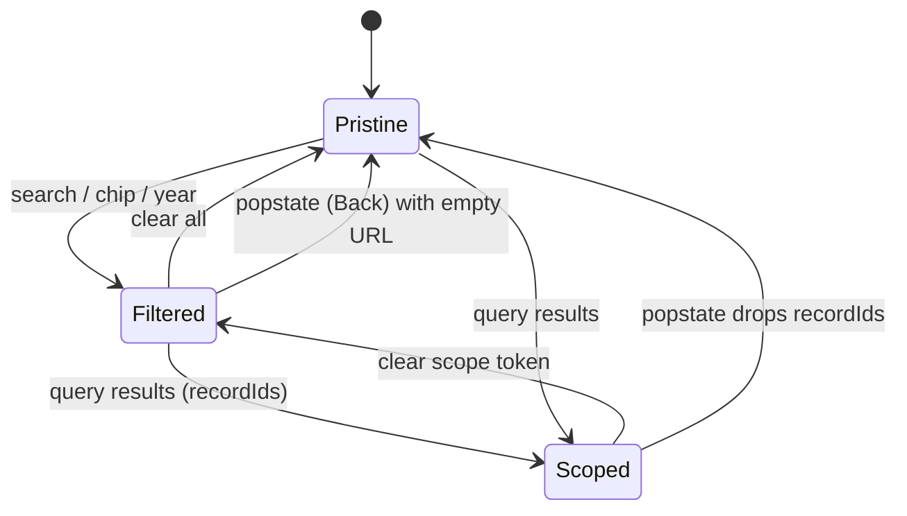

### F3 selected record

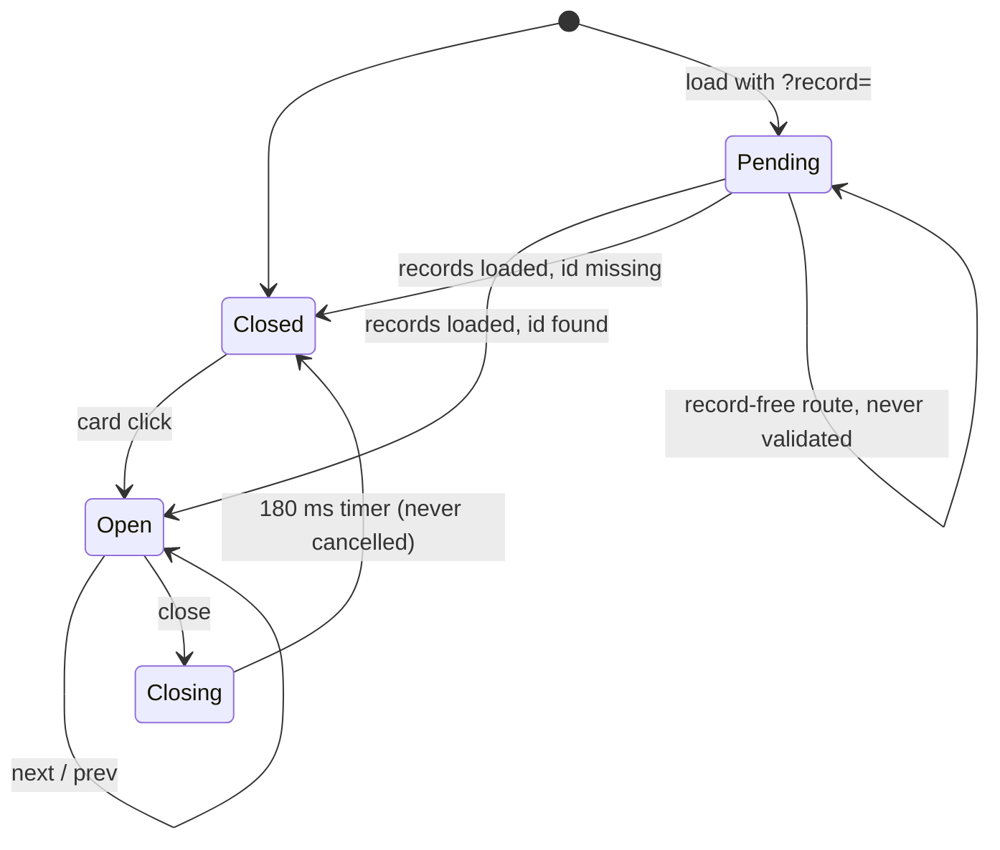

### F5 core data gate

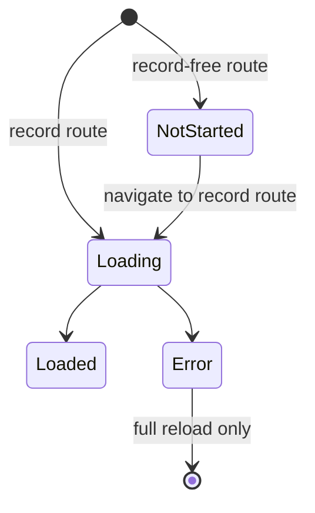

### F6 cache tiers

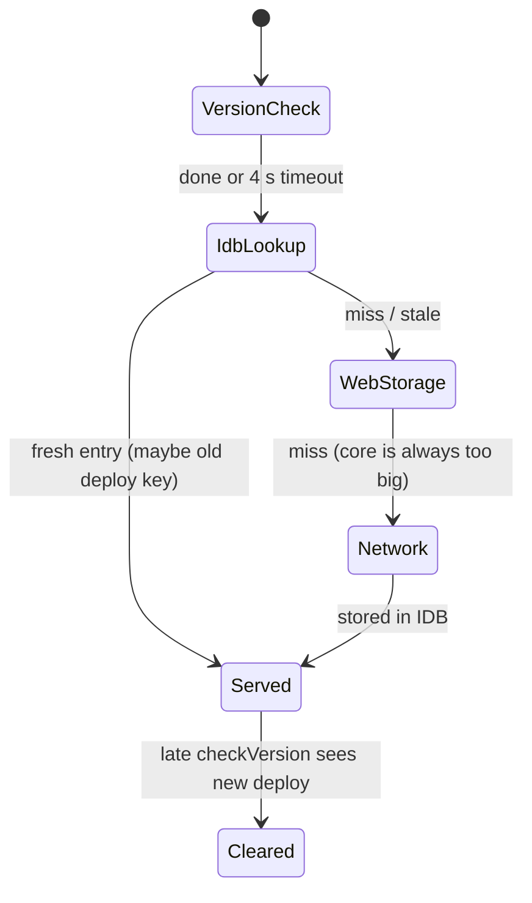

### F9 semantic toggle

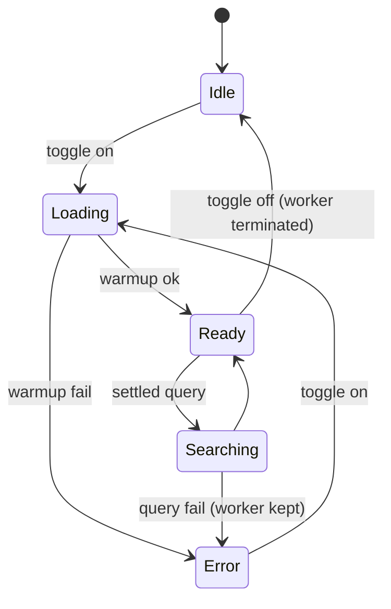

### F12 service worker

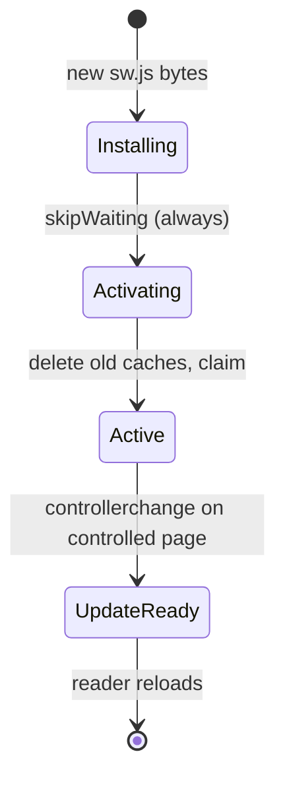

### F13 desktop window

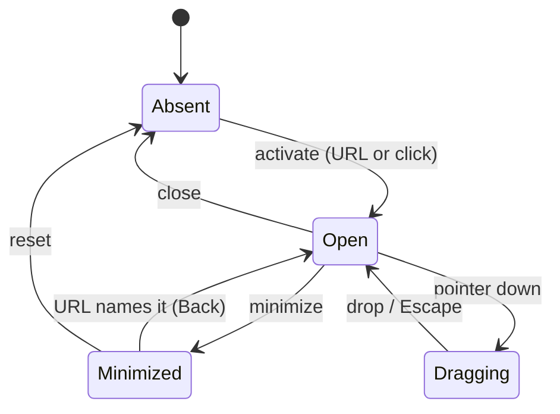

### Q1 queue row

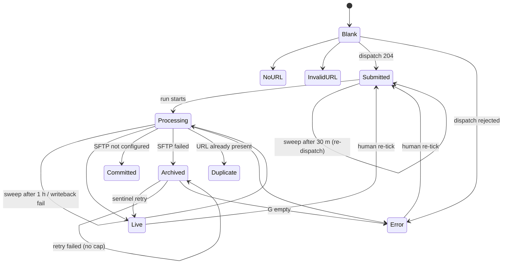

### Q4 release FIFO

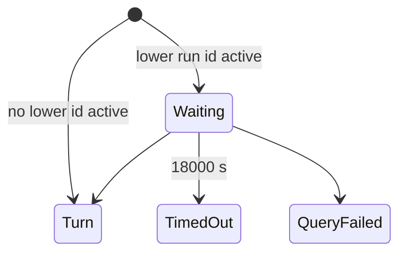

### R2 capture journal

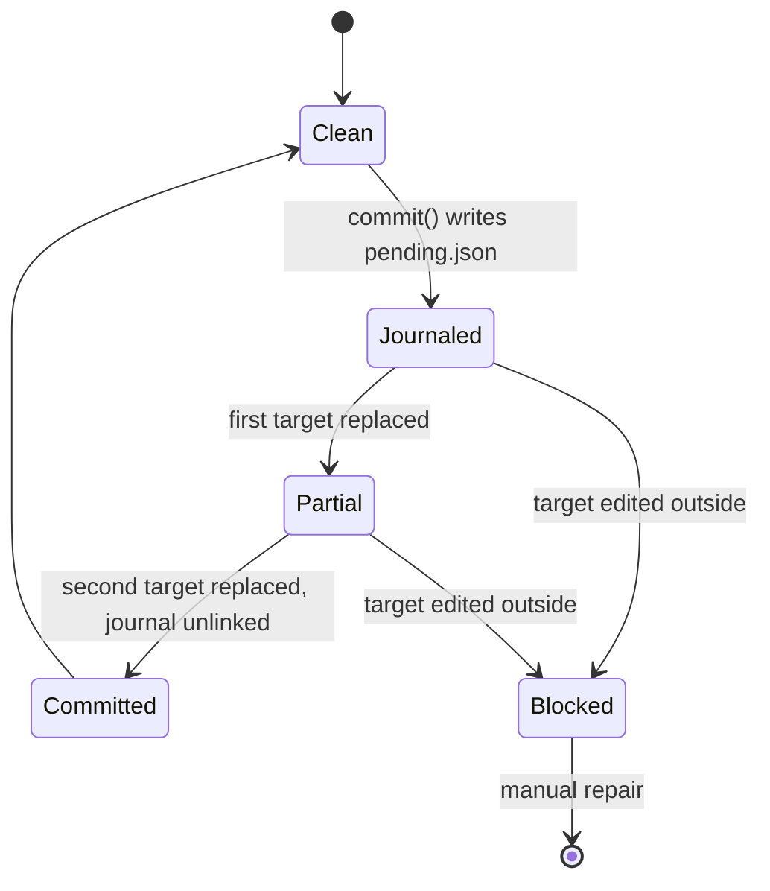

### R3 source chain

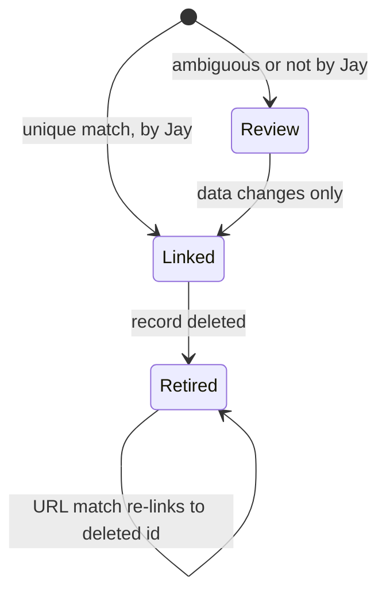

### R4 THREAD id

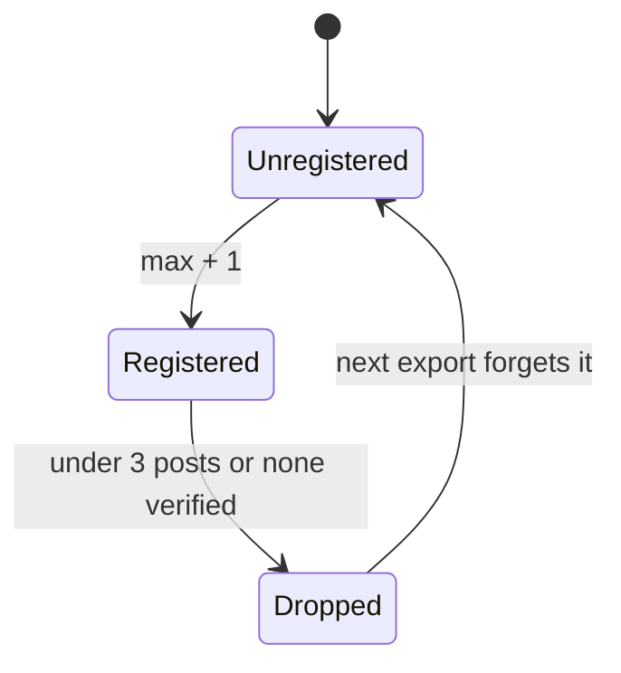

### W1 stewardship phase

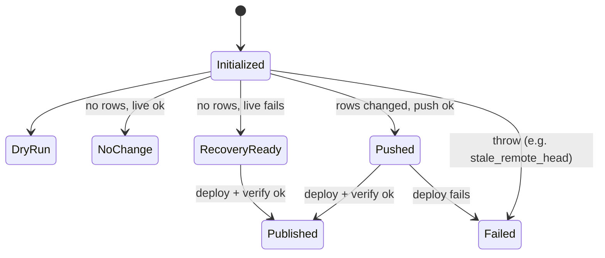

### R10 version stamping

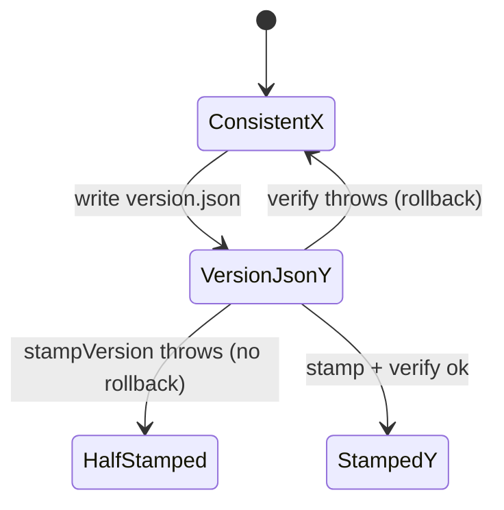

## Overlap and redundancy

- **The queue row has two status vocabularies.** Apps Script writes `submitted`, `no URL`, `invalid URL` and `error` (`automation/apps-script/Code.gs:109-118`). Python writes `processing`, `live`, `committed`, `archived`, `duplicate` and `error` (`backend/scripts/process_submission.py:801,1233-1277`). The docstring adds `noop`, which no code writes (`process_submission.py:33`). The sweeper workflow comment leaves out `committed` (`.github/workflows/sweep-stuck-rows.yml:7-8`), but the script lists it (`backend/scripts/sweep_stuck.py:16-19`).
- **The queue row has two writers and no compare-and-set.** Apps Script and every Action run write F, G and H as a blind batch update (`backend/submission_runtime/sheets_callback.py:75-92`). The sweeper adds extra runs for the same row (`sweep_stuck.py:242-299`).
- **The record lifecycle has two machines.** Q1 (the sheet row) and R5 (the CSV flags) both track one submission. When the step-12 writeback fails, the record is live in R5 and still reads `processing` in Q1 (`process_submission.py:1267-1275`).
- **`verified` has two meanings.** It gates visibility in the exporter (`data/export-archive-data.js:115-118,1028`). For BSKY rows it is also the accept/reject decision sent to the discovery worker (`backend/scripts/post_ingestion_receipt.py:178-217`). Review status sits in a third column, `needs_review` (`process_submission.py:1013`).
- **Writers spell `verified` in different ways.** The exporter accepts `TRUE`, `true`, `Yes` or a boolean (`export-archive-data.js:115-118`). The quality evaluator accepts only `TRUE` or `FALSE` (`scripts/evaluate-source-identity-quality.mjs:350-362`). `needs_review` is `true` in `process_submission.py:1013` and `TRUE` in `pressthink_batch_update.py:252-254`.
- **Two places define the default filters.** `DEFAULT_FILTERS` (`frontend/App.js:160-169`) has `recordIds`. `defaultFilters()` (`frontend/services/viewState.js:68-80`) does not. They can drift apart.
- **Three effects write `?record=`.** The standard replaceState effect (`App.js:366-379`), the desktop `viewStateToUrl` effect (`App.js:384-399`) and the entities effect (`App.js:403-414`) all write it. Guard flags keep them apart.
- **The desktop active window is stored in two places.** The active app is in the URL hash. Z-order and minimized state are in localStorage (`frontend/desktop/DesktopShell.js:202-205,213-227`). They can disagree after a Back.
- **Two copies of the route parse run on each Back.** `syncRoute` listens to both `hashchange` and `popstate` (`App.js:357-358`), so it runs twice for one Back over a hash entry.
- **Two semantic worker clients have opposite abort rules.** The search client keeps its worker on abort (`frontend/services/semanticSearch.js:5`). The recall client terminates its worker when the last request aborts (`frontend/services/semanticRecall.js:156-163`).
- **Two ID allocators.** `RECORD-*` IDs use the high-water sequence (`backend/scripts/record_id_sequence.py:89-96`). `THREAD-*` IDs and the source-based IDs use a max-scan. `THREAD-*` takes the prior runtime artifact as its registry (`data/lib/thread-id-allocator.js:113-160`).
- **The deploy version is stored in two places.** It is in localStorage `jrda_deploy_version`, written by `checkVersion` (`frontend/services/archiveService.js:205-220`), and it is part of the IDB key (`archiveService.js:322-329`). If the check is slow, the key uses the old version.
- **Two files rewrite `graph-validation-holds.json`.** `graph-policy-refresh.js` keeps hand formatting. `refresh-social-release-artifacts.mjs:239` assigns the whole policy again and serializes it.
- **Two transfer modules write the same remote host.** `deploy_full_site.py:897-1037` and `sftp_push.py:42-96` both write it. Only the release FIFO keeps them to one writer at a time.
- **Two supersession markers in preservation manifests.** The `review.state` `superseded` and the `supersedesEventId` chain are independent (`preservation/validate-preservation-manifests.mjs:401-429,737-773`).

## Problems

Ranked by severity: data loss or wrong public data first, then stuck automation, then UX, then latent.

1. **High: the sweeper re-dispatches rows whose runs are still in flight.** Age comes from column A, the submission time (`backend/scripts/sweep_stuck.py:137,203-214,255`). The sweeper never checks for a queued run. Scenario: a submission waits 2 h in the release FIFO (limit 18000 s, `.github/workflows/submit-record.yml:81`). Sweeps at 30, 60 and 90 min each dispatch another run. The first run sets `live`. Each later run dedups, pushes the whole site again, and rewrites the row `processing` and then `duplicate` (`process_submission.py:801,807-814,430`).
2. **High: `archived` has no retry cap.** Scenario: a transfer fails for good, for example because `ROSEN_SFTP_TRANSACTION_PATH` is missing (`backend/scripts/deploy_full_site.py:691-697`). After 24 h the sweeper dispatches a full-site sentinel retry on every 30-minute tick, without end (`sweep_stuck.py:258-280`). Each retry waits its turn in the FIFO and delays real releases.
3. **High: a re-run of an old release run can run at the same time as a newer one.** The FIFO orders runs by run id (`.github/scripts/wait-release-turn.mjs:25-37`). A re-run attempt keeps its original id. Scenario: someone re-runs a failed deploy from yesterday while today's submission holds the turn. Both write FTPS paths at the same time. Recall-pair recovery can then interleave (`deploy_full_site.py:738-793`).
4. **High: THREAD ids can be reused.** Nothing records a dropped thread. Scenario: THREAD-00009, the highest id, loses its verified member and drops out (`data/lib/thread-id-allocator.js:85-92`). The next export registers only up to 00008, so a new root gets THREAD-00009 (`thread-id-allocator.js:155-158`). Old `?record=THREAD-00009` links now open a different thread.
5. **High: a slow `version.json` can serve stale core data after a deploy.** Scenario: `version.json` takes 5 s, so `checkVersion` loses the 4 s race (`frontend/services/archiveService.js:229,346`). `coreIdbKey()` reads the previous deploy version and returns the previous release's blob for up to 30 min (`archiveService.js:322-336`). Then the background check clears the caches under the running page.
6. **High: the SW mixes module releases on a lazy import.** Install always calls `skipWaiting` and activate deletes old caches (`frontend/sw.js:203,216-226`). Scenario: a reader has the old page open and opens the desktop. The old page imports `DesktopShell.js?v=<old>`. The cache misses, the server returns the new bytes, and `cacheFirst` stores them under the old key (`sw.js:387`). The old shell runs with new modules until the reader reloads.
7. **Medium: Back resets the archive search.** Every `popstate` replaces the filters with the URL params (`frontend/App.js:339-345`). The standard archive never writes its filters to the URL. Scenario: the reader searches "view from nowhere", opens #about, and presses Back. The search and categories are cleared. The comment at `App.js:333-338` says plain navigation keeps the filters, but that is true only for `hashchange`.
8. **Medium: shared `?pub=` and `?replies=1` links do nothing.** `parseViewState` reads both (`viewState.js:141-143`), but `filteredRecords` never checks `publication` or `includeReplies` (`App.js:749-805`). Scenario: a desktop link shared with `?pub=PressThink` shows all publications.
9. **Medium: a stewardship run fails when `main` moves.** `assertRemoteHeadUnchanged` throws `stale_remote_head` if any merge lands after the tested checkout (`.github/scripts/bluesky-stewardship-publisher.mjs:501-507,559`). There is no retry before the next daily cron at 18:47, 19:47 or 20:47 UTC (`.github/workflows/*-stewardship.yml:5`). Scenario: someone merges a stack of PRs at 19:00 and the PressThink run that day fails.
10. **Medium: reaching zero divergence fails releases.** Scenario: a fix removes the last relationship row that diverges. The census reports "can be flipped to enforced" as a problem (`data/lib/graph-policy-refresh.js:277`), and the refresh throws (`scripts/refresh-social-release-artifacts.mjs:234-236`). Every stewardship release fails until a curator edits the registry.
11. **Medium: `generatedPublishedRecordIds` is never pruned.** The refresh only appends (`refresh-social-release-artifacts.mjs:146-155`). Scenario: a thread falls out of publication. Validation then sees a stale exception (`scripts/validate-graph-data.mjs:775-778`), and the next release fails until someone edits the file.
12. **Medium: JS fix scripts ignore the capture journal.** Only the Python writers call `assert_no_pending_capture` (`backend/scripts/record_id_sequence.py:38-47`). Scenario: on a local checkout, a capture crashes and leaves `pending.json`. A curator then runs a `data/fixes/*.js` script. `recover()` raises "changed outside the pending transaction" (`backend/scripts/pressthink_transaction.py:81-85`), and every `RECORD-*` writer is blocked.
13. **Medium: failed extractions are never retried.** `get_processed_ids` returns failed rows too (`backend/src/rosen_scraper/extraction_db.py:153-162`), and the batch runner skips them (`backend/scripts/batch_entity_extraction.py:504-505`). Scenario: a Gemini outage marks 50 records `failed`, and they never get relationships.
14. **Medium: a misnamed SFTP secret parks rows for good.** `cfg is None` returns `skipped` (`backend/submission_runtime/sftp_push.py:65-67`), and the row then gets the terminal state `committed` (`process_submission.py:1220-1243`). Scenario: someone renames a secret. Every submission lands on `main` but never goes live, and nothing retries it.
15. **Medium: the core load error is terminal.** `coreFetchStarted` is never reset (`App.js:530-532`). Scenario: a short network drop on first load shows the error until a full reload, even after the network returns.
16. **Low: an unparseable timestamp hides a stuck row.** `_age_seconds` returns -1 (`sweep_stuck.py:203-207`), so `_is_stuck` is always false. Scenario: someone edits column A by hand to "yesterday", and the row stays in `submitted` for good.
17. **Low: a failed semantic query leaves the worker alive.** The error path sets `enabled=false` but does not call `terminateSemanticSearch` (`App.js:717-726`; compare `App.js:680`). Scenario: one query times out. The toggle shows off while the model stays in memory.
18. **Low: the modal close timer is never cancelled.** `setTimeout(..., 180)` has no clear (`frontend/components/RecordModal.js:348`). Scenario: the reader closes the modal and clicks another card within 180 ms. The timer then calls `onClose` and closes the new record.
19. **Low: the desktop close and minimize use stale layout.** They compute from the render-time layout, not a functional updater (`DesktopShell.js:805-824`). Scenario: a drag-end update is queued, then a close drops that position. No `storage` listener exists, so two tabs overwrite each other's layout.
20. **Low: a half-built SQLite DB is kept.** `db` is set before `createTables()` (`frontend/services/sqliteService.js:99-103`). Scenario: `createTables` throws, and the next `initDatabase` returns the same broken `db` (`sqliteService.js:76`).
21. **Low: the version bump has no rollback for a stamp failure.** `stampVersion` runs outside the try (`scripts/bump-version.mjs:109-117`). Scenario: a file read error mid-loop leaves `version.json` at Y and some markers at X.
22. **Low: the sync PR can be orphaned.** If `git push` succeeds and `gh pr create` fails, the branch has no PR (`backend/scripts/sync_sheet_to_archive.py:429-454`). Also, an empty sheet cell never clears a CSV value (`sync_sheet_to_archive.py:90-93`).
23. **Low: the quality state `stale` cannot be reached.** It is required and counts as failing (`scripts/evaluate-source-identity-quality.mjs:18,85`), but no evaluator emits it.
24. **Low: the banner can shift the layout.** It starts hidden and is shown in a mount effect (`frontend/components/WorkInProgressBanner.js:28-40`), and App renders it in the page (`App.js:1249`). That is a shift with no input, unless the CSS takes it out of flow. I did not check the CSS.

## Suggested follow-up issues

1. Measure sweeper age from the last status write, not from column A, and record that time in a new column.
2. Make the sweeper skip a row when a `submit-record.yml` run for that `sheet_row` is queued or in progress. Fixed (the run title now names the row, and the sweeper skips rows with an active run and dispatches nothing when the lookup fails).
3. Add an attempt counter for `archived` rows and stop sentinel retries after a fixed limit.
4. Order the release FIFO by run creation time or by `run_attempt` start time, not by run id alone.
5. Add a tombstone list of retired THREAD ids to the exporter so that it never reuses a number.
6. Make `fetchCoreData` skip the IDB read when `checkVersion` times out, so that it never serves an old deploy key.
7. Stop the SW from deleting the previous release's cache until no client of that release remains.
8. Remove the `popstate` filter overwrite outside desktop routes, or write standard archive filters to the URL.
9. Apply `publication` and `includeReplies` in `filteredRecords`, or stop parsing them from the URL.
10. Retry a stewardship run once after `stale_remote_head` by rebasing onto the new `origin/main`.
11. Treat zero endpoint divergence as a warning in `refresh-social-release-artifacts.mjs`, not as a thrown error.
12. Prune `generatedPublishedRecordIds` entries in the refresh when the record is no longer published.
13. Add the pending-journal check to the JS CSV writers in `data/fixes/` and `data/lib/python-csv-maintenance.js`.
14. Exclude `failed` rows from `get_processed_ids` so that the batch runner retries them.
15. Return a failure instead of `skipped` from `push_full_release` when the job expects SFTP secrets.
16. Reset `coreFetchStarted` on error and add a retry button that fetches again without a page reload.
17. Treat an unparseable column A timestamp as stuck and log it in `sweep_stuck.py`.
18. Call `terminateSemanticSearch` on the semantic query error path in `App.js`.
19. Cancel the 180 ms close timer in `RecordModal.js` when the record changes or the component unmounts.
20. Use functional `setLayout` updaters in `closeWindow` and `minimizeWindow` in `DesktopShell.js`.
21. Set `db` only after `createTables` succeeds in `sqliteService.js`.
22. Move `stampVersion` inside the rollback try in `scripts/bump-version.mjs`.
23. Delete the pushed branch when `gh pr create` fails in `sync_sheet_to_archive.py`.
24. Remove the unused `noop` status from the `process_submission.py` docstring, and add `committed` to the sweeper workflow comment.
25. Use one spelling (`TRUE`/`FALSE`) for `verified` and `needs_review` in all writers, and make one validator enforce it.
26. Use one shared default filter object for `App.js` and `viewState.js`.
